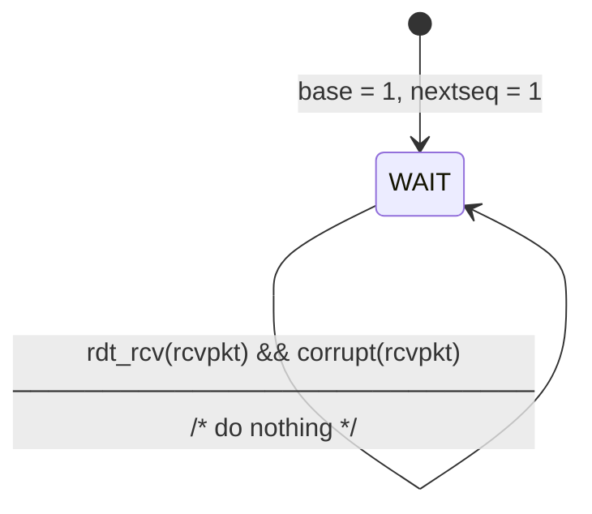
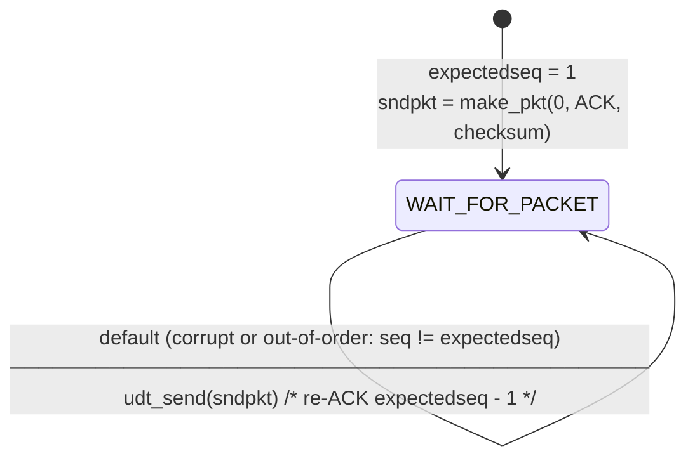

# Go-Back-N (GBN) Sender Finite State Machine (FSM)

Reference: Kurose & Ross, Computer Networking: A Top-Down Approach, Section 3.4.3.

---

## 1. State Machine Diagram

---

## 2. Invariants & State Variables

The GBN sender maintains **exactly three** state variables:
1. `base`: Sequence number of the oldest unacknowledged transmitted packet.
2. `nextseq`: Next sequence number to be assigned to outgoing application data.
3. `window` ($N$ or $W$): Window size limit representing the maximum number of unacknowledged packets permitted in flight.

**Fundamental Invariant:**
$$\text{nextseq} - \text{base} \le \text{window}$$

---

## 3. Transition Breakdown

### Transition 1: `rdt_send(data)` (Under Window Limit)
* **Trigger:** The application layer invokes `rdt_send` with a payload.
* **Guard:** $\text{nextseq} < \text{base} + N$ (`can_send() == True`).
* **Actions:**
  1. Construct packet: `sndpkt[nextseq] = make_pkt(nextseq, data, checksum)`.
  2. Send packet to network: `udt_send(sndpkt[nextseq])`.
  3. Timer check: If the window was previously empty ($\text{base} == \text{nextseq}$), start the timer for this newly sent oldest packet.
  4. Advance next sequence number: `nextseq = nextseq + 1`.

### Transition 2: `rdt_send(data)` (Window Full)
* **Trigger:** The application layer invokes `rdt_send` while $\text{nextseq} \ge \text{base} + N$ (`can_send() == False`).
* **Action:** Refuse the data or block until space becomes available. In pure logic, `SendWindow.next_seq()` raises a `RuntimeError`.

### Transition 3: `timeout`
* **Trigger:** The single sender timer expires, indicating that packet `base` was not acknowledged within the round-trip deadline.
* **Actions:**
  1. Restart the timer: `start_timer()`.
  2. Retransmit **every** packet currently in flight, from `sndpkt[base]` through `sndpkt[nextseq - 1]`.
  3. This burst retransmission gives the protocol its name: **Go-Back-N**.

### Transition 4: `rdt_rcv(rcvpkt) && notcorrupt(rcvpkt)` (Valid Cumulative ACK)
* **Trigger:** An intact packet arrives from the receiver containing cumulative ACK number $n$.
* **Actions:**
  1. Advance `base`: Since ACK $n$ confirms receipt of all sequence numbers up to and including $n$, `base` advances to $n + 1$.
  2. Timer management:
     - If all sent packets are now acknowledged ($\text{base} == \text{nextseq}$), stop the timer.
     - Otherwise, there are still unacknowledged packets in flight; restart the timer to count down for the new oldest unacknowledged packet (`base`).

### Transition 5: Corrupt Packet or Stale Duplicate ACK
* **Trigger:** A packet arrives that is either corrupted (fails checksum check) or has an ACK number strictly less than `base` ($ack < base$).
* **Action:** Discard the packet and take no action.

---

## 4. Receiver State Machine Diagram

---

## 5. Receiver Transition Breakdown

### Transition R1: In-Order, Uncorrupted Packet
* **Trigger:** A packet arrives with sequence number exactly matching `expectedseq` and passing the checksum.
* **Actions:**
  1. Extract payload: `extract(rcvpkt, data)`.
  2. Deliver to application layer: `deliver_data(data)`.
  3. Generate and send ACK for `expectedseq`: `sndpkt = make_pkt(expectedseq, ACK, checksum); udt_send(sndpkt)`.
  4. Advance expected sequence: `expectedseq = expectedseq + 1`.

### Transition R2: Corrupted or Out-of-Order Packet
* **Trigger:** A packet arrives that is corrupted or has a sequence number different from `expectedseq` ($seq \ne expectedseq$).
* **Action:**
  1. **Discard the packet**: GBN receiver has zero buffer. Out-of-order packets are dropped immediately.
  2. **Re-ACK last in-order sequence**: Retransmit `sndpkt` (which contains ACK for `expectedseq - 1`).
  3. This duplicate ACK informs the sender that an expected packet is missing and prompts cumulative synchronization.

---

## 6. Kurose 3.4.3 Diff: Textbook FSM vs. Implementation Architecture

| Dimension | Kurose Section 3.4.3 Textbook FSM | Our Python Pure-Logic Architecture (`rdt/window.py`) |
| :--- | :--- | :--- |
| **Separation of Concerns** | Monolithic state machine tightly coupling socket I/O, timers, and sequence bookkeeping. | Pure-logic component (`SendWindow`). Zero I/O, zero time, zero socket imports. Testable deterministically. |
| **Full Window Handling** | `refuse_data(data)` / application backpressure. | `can_send() -> bool` guard; calling `next_seq()` on full window raises `RuntimeError`. |
| **Timer Management** | Explicit single timer `start_timer()` / `stop_timer()` inside the FSM action block. | Decoupled timer heap managed in network event loop via `select()`. Window exposes `outstanding()` to indicate what to retransmit. |
| **Cumulative ACK Semantics** | Advances `base = getacknum(rcvpkt) + 1`. Does not explicitly guard against future/unsent ACKs. | `on_ack(ack)` explicitly guards against both stale ACKs ($ack < base$) and unsent ACKs ($ack \ge nextseq$), returning exact slide delta. |
| **Receiver Buffering** | Zero buffer. Drops all out-of-order packets immediately. | Identical zero-buffer design. Eliminates packet reordering complexity at the receiver at the expense of duplicate retransmissions. |

---

## 7. Sequence Number Space Proof ($W + 1$ Invariant)

In Go-Back-N, the sequence number space size $M$ must satisfy:
$$M \ge W + 1$$
where $W$ is the transmission window size.

### Failure Proof when $M = W$:
Suppose window size $W = 4$ and sequence number space $M = \{0, 1, 2, 3\}$ ($M = W$):
1. **Initial Burst:** Sender transmits packets $0, 1, 2, 3$. All four packets arrive safely at the receiver.
2. **Receiver Actions:** The receiver accepts and delivers packets $0, 1, 2, 3$ in order. The receiver’s `expectedseq` wraps from $3 \to 0$. Receiver transmits ACKs $0, 1, 2, 3$.
3. **Total ACK Loss:** Suppose all four ACKs ($0, 1, 2, 3$) are lost or delayed in the channel.
4. **Sender Timeout:** Sender's single timer expires for packet $0$. Sender retransmits packets $0, 1, 2, 3$.
5. **Catastrophic Failure:** Packet $0$ arrives at the receiver. The receiver is currently expecting sequence number $0$. Because $0 == expectedseq$, the receiver accepts this packet as **brand new data**, delivering duplicate payload to the application layer.

With sequence space $M \ge W + 1$ (e.g., $M = 5$ with sequences $\{0, 1, 2, 3, 4\}$):
* After receiving packets $0, 1, 2, 3$, the receiver expects packet $4$.
* If all ACKs are lost and sender retransmits packet $0$, receiver sees $seq = 0 \ne 4$.
* Receiver correctly detects it as a duplicate, drops it, and re-ACKs packet $3$. Data integrity is preserved.

---

## 8. Failure Modes & Edge Case Analysis

1. **Lost Cumulative ACKs:**
   - In GBN, individual ACK loss is frequently self-healing. If ACKs $1, 2$ are dropped by the channel but ACK $3$ arrives before timeout, `on_ack(3)` advances `base` past $1, 2$ and $3$ seamlessly. No retransmissions occur.
2. **Lost Data Packet:**
   - If packet $k$ is dropped while packets $k+1 \dots k+N-1$ arrive, the receiver drops every subsequent packet and sends duplicate ACKs for $k-1$. When the sender's timer for packet $k$ expires, the sender executes "Go Back N" and retransmits all packets in `outstanding()` ($k \dots nextseq - 1$).
3. **Degenerate Window ($W = 1$):**
   - When $W = 1$, `can_send()` allows exactly one packet before blocking. `SendWindow` behaves identically to Stop-and-Wait ARQ (RDT 3.0), validating protocol continuity.

